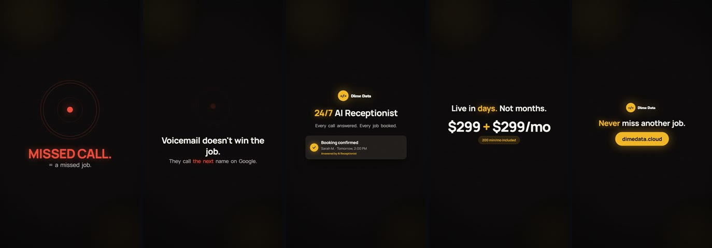
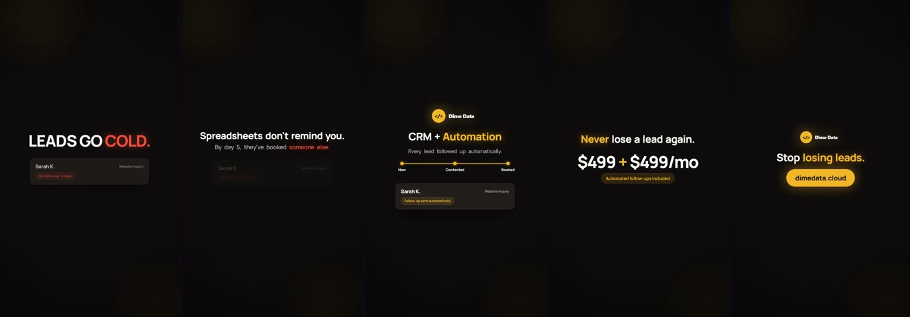

# remotion-ad-series

Vertical video ads (1080×1920, 18 seconds), written as React components and rendered with
[Remotion](https://www.remotion.dev). Each ad is its own Remotion project.

**receptionist-v1**: 24/7 AI receptionist



**crm-v1**: CRM and automation



Rendered MP4s are not stored in this repository, because video binaries do not belong in git. Render
them locally with the commands under [Render](#render).

## The structure every ad shares

Five scenes on one timeline, at 30 fps:

| Scene | Frames | Job |
|---|---|---|
| Hook | 0-90 | Name the pain in a few words |
| Agitate | 90-225 | Make it cost something |
| Solution | 225-390 | Show the product doing the job |
| Proof | 390-480 | Price and speed, stated plainly |
| CTA | 480-540 | One action, one URL |

The scene lengths are constants at the top of each `AdVideo.tsx`, and every `start` is derived
from the one before it. Retiming a scene moves everything after it.

```
<ad>/src/
  Root.tsx           composition: size, fps, duration
  AdVideo.tsx        the timeline, five <Sequence>s
  scenes/            Hook, Agitate, Solution, Proof, CTA
  components/        WordReveal, PriceCard, Overlay, Background, Logo, plus one hero
                     component per ad (PhoneRings / BookingCard, PipelineTrack / LeadCard)
  theme.ts           colours and spacing
  fonts.ts           Manrope via @remotion/google-fonts
```

## Render

```bash
cd receptionist-v1        # or crm-v1
npm install
npx remotion studio       # preview and scrub in the browser
npm run render            # writes out/*.mp4
```

### Windows on ARM64

Remotion doesn't ship an ARM64 Windows compositor, but the x64 one runs under emulation:

```bash
npm install @remotion/compositor-win32-x64-msvc --force --no-save
```

Then, in `node_modules/@remotion/renderer/dist/compositor/get-executable-path.js`, add
`case 'arm64':` to the `win32` switch so it falls through to the x64 package. Point
`--browser-executable` at an x64 `chrome-headless-shell.exe`, for example the one Playwright
installs.

### What was verified

Checked on Windows 11 ARM64 (Node 24.16.0, npm 11.19.0):

- `npm install` in each project completes.
- The bundler needs its arm64 native binding on this machine. npm picks the x64 one and fails with
  `Cannot find native binding`. `npm install --no-save --force @rspack/binding-win32-arm64-msvc@1.7.11`
  fixes it, and `npx remotion bundle src/index.ts out/bundle` then succeeds in both projects.
- `npx remotion still src/index.ts DimeDataCRMAd out/still-crm.png --frame=60
  --browser-executable="<path to chrome.exe>"` renders a frame with a locally installed Google Chrome.
  Without `--browser-executable`, Remotion cannot download a Chrome Headless Shell for arm64 Windows.
- A full MP4 render was not run.

## License

Code is MIT. The Dime Data name and logo in `public/` aren't licensed for reuse, so swap in
your own. Remotion has [its own licence terms](https://www.remotion.dev/license) for companies.
Built by [Dime Data](https://dimedata.cloud).
